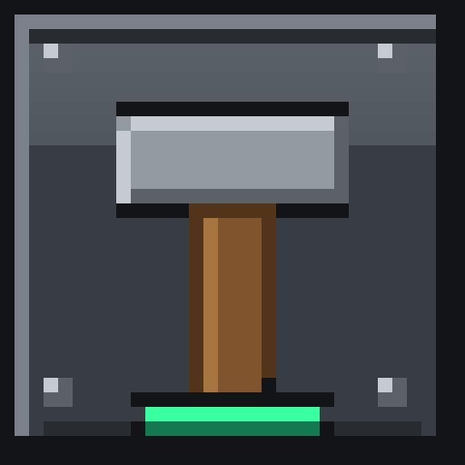
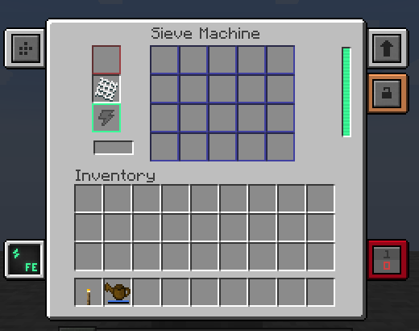
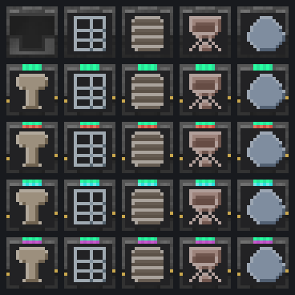
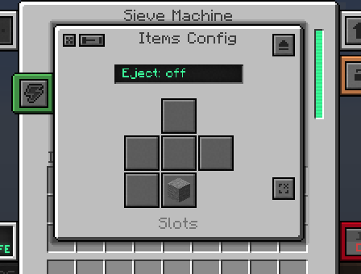
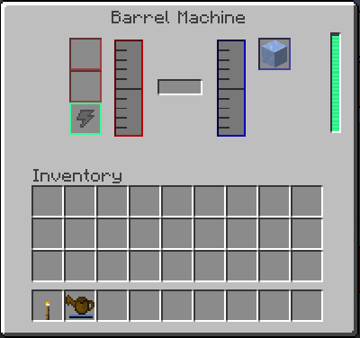
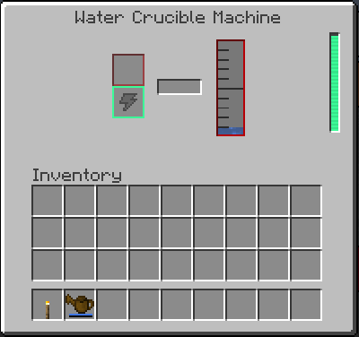
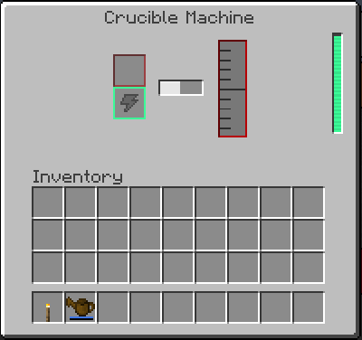
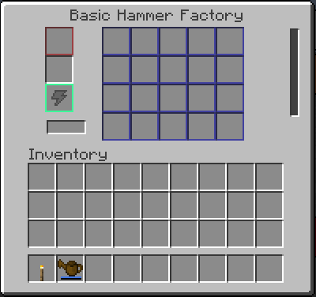

<p align="center"></p>

# Ex Mekanism Deorum

**Ex Deorum の機械を、Mekanism の機械として使えるようにする NeoForge Mod です。**

ハンマー / ふるい / バレル / るつぼ / 水るつぼを、Mekanism と同じ操作感
（FE 給電・アップグレード・側面設定・セキュリティ）で自動化できます。
レシピは Ex Deorum のレシピキャッシュを直接参照するため、
**データパックで追加したレシピもそのまま動きます**。

| 項目 | 内容 |
| --- | --- |
| Minecraft / NeoForge | 1.21.1 / 21.1.265 以降 |
| 必須依存 | Ex Deorum 3.12 以降 / Mekanism 10.7.19 以降 |
| この Mod のバージョン | 0.2.1（テクスチャ・GUI は仮アセット） |
| 導入先 | クライアントとサーバーの両方（コンフィグなし） |
| ブロック数 | 基本 25 種／連携 Mod がすべて入れば最大 90 種（下記） |



## 目次

- [特徴](#特徴)
- [導入方法](#導入方法)
- [追加される機械とティア](#追加される機械とティア)
- [使い方](#使い方)
- [クラフトレシピ](#クラフトレシピ)
- [互換 Mod（すべて任意）](#互換-modすべて任意)
- [JEI 連携](#jei-連携)
- [スクリーンショット](#スクリーンショット)
- [既知の制限](#既知の制限)
- [カスタマイズ / 開発](#カスタマイズ--開発)
- [ライセンス / クレジット](#ライセンス--クレジット)

## 特徴

- **最大 90 ブロック** — 無印の機械 5 種 + ファクトリー 85 種。
  内訳は Mekanism の 4 ティア + Evolved Mekanism の 5 ティア +
  Mekanism Extras の 4 ティア + Evolved Mekanism Extras の 4 ティア（各 5 ファミリー）。
  連携 Mod がない環境では基本の 25 ブロックだけが登録されます。
- **レシピ自動参照** — Ex Deorum のハンマー・ふるい・バレル・るつぼレシピをそのまま使用
  （データパック追加分も自動で対象になります）。
- **Mekanism 統合** — FE で動作。スピード / エネルギー / マフリングのアップグレード、
  側面設定、セキュリティ、レッドストーン制御、JEI 触媒に対応します。
- **ファクトリーの並列処理** — Basic 4 / Advanced 8 / Elite 12 / Ultimate 16 レーン。
  連携 Mod を入れると 20〜64 レーンの追加ティアも使えます（るつぼはレーンではなく速度倍率）。
- **圧縮ハンマー対応** — 圧縮ハンマーをセットすると `compressed_hammer` レシピを処理し、
  結果も `compressed_*` アイテムで出力します。
- **大容量バッファ** — 入力スロットは 64 × 並列数、内部 FE は 40,000 × 並列数まで保持します。
- **アニメーション** — 前面 LED が待機中は呼吸、稼働中は明滅 + 走査線で光ります。



## 導入方法

1. Minecraft 1.21.1 + NeoForge 21.1.265 以降の環境を用意する
2. [Ex Deorum](https://modrinth.com/mod/ex-deorum) 3.12 以降を入れる
3. [Mekanism](https://modrinth.com/mod/mekanism) 10.7.19 以降を入れる
4. この Mod の jar を `mods/` に入れる

クライアント・サーバーの両方に入れてください。コンフィグはありません。

## 追加される機械とティア

### 機械ファミリー

| ファミリー | 無印の機械 | ファクトリー名の形 | 1 レーンあたりの消費 |
| --- | --- | --- | --- |
| ハンマー | `hammer_machine` | `<tier>_hammer_factory` | 20 FE/t |
| ふるい | `sieve_machine` | `<tier>_sieve_factory` | 40 FE/t |
| バレル | `barrel_machine` | `<tier>_barrel_factory` | 10 FE/t |
| 溶岩るつぼ | `crucible_machine` | `<tier>_crucible_factory` | 20 FE/t × 溶解倍率 |
| 水るつぼ | `water_crucible_machine` | `<tier>_water_crucible_factory` | 20 FE/t × 溶解倍率 |

- ハンマー / ふるい / バレルのファクトリーは、並列数ぶんのレーンを同時に処理します。
  ティアによる速度ボーナスはなく、1 レーンあたりの FE は無印と同じです。
- **るつぼファクトリーだけは例外**で、レーンを増やさず溶解速度を上げます。
  電力も同じ倍率で増えるため、液体 1 単位あたりの FE は無印と同じです。
- 設置直後の側面設定は Mekanism の機械と同じです
  （アイテム: 全側面入力 + 右出力 + 背面エネルギー、エネルギー: 全側面入力、
  バレル / るつぼの液体: 全側面入出力）。ケーブルやパイプは設置してそのまま接続できます。
- 登録されたブロックはすべてクリエイティブタブ `Ex Mekanism Deorum` に入っています。

### ティア一覧（並列数・るつぼ倍率・エネルギー容量）

内部 FE バッファは **40,000 FE × 並列数** です。ファクトリーは 1 tick の消費も
並列数だけ増えるため、容量も同じ比率で増やして「バッファで動ける時間」を無印と揃えています。
入力スロットの上限も **64 × 並列数** です（例: Basic 256、Ultimate 1,024）。

| ティア | 追加元 | 並列数 | るつぼ倍率 | FE 容量 |
| --- | --- | ---: | ---: | ---: |
| 無印 | — | 1 | 1 倍 | 40,000 FE |
| Basic | Mekanism | 4 | 5 倍 | 160,000 FE |
| Advanced | Mekanism | 8 | 10 倍 | 320,000 FE |
| Elite | Mekanism | 12 | 20 倍 | 480,000 FE |
| Ultimate | Mekanism | 16 | 30 倍 | 640,000 FE |
| Overclocked | Evolved Mekanism | 20 | 40 倍 | 800,000 FE |
| Quantum | Evolved Mekanism | 24 | 50 倍 | 960,000 FE |
| Dense | Evolved Mekanism | 28 | 60 倍 | 1,120,000 FE |
| Multiversal | Evolved Mekanism | 32 | 70 倍 | 1,280,000 FE |
| Creative | Evolved Mekanism | 36 | 80 倍 | 1,440,000 FE |
| Absolute | Mekanism Extras | 20 | 40 倍 | 800,000 FE |
| Supreme | Mekanism Extras | 24 | 50 倍 | 960,000 FE |
| Cosmic | Mekanism Extras | 28 | 60 倍 | 1,120,000 FE |
| Infinite | Mekanism Extras | 32 | 70 倍 | 1,280,000 FE |
| Absolute Overclocked | Evolved Mekanism Extras | 40 | 90 倍 | 1,600,000 FE |
| Supreme Quantum | Evolved Mekanism Extras | 48 | 100 倍 | 1,920,000 FE |
| Cosmic Dense | Evolved Mekanism Extras | 56 | 110 倍 | 2,240,000 FE |
| Infinite Multiversal | Evolved Mekanism Extras | 64 | 120 倍 | 2,560,000 FE |

速度アップグレードを盛って 1 tick の消費が容量を超える場合は、容量を上限に動き続けます
（完全停止はしません）。

### 追加ティアについて

- 追加ティアのブロックは **対応する Mod が入っているときだけ登録されます**
  （Mod なしなら Mekanism の 25 ブロックのみ）。レシピにも `neoforge:mod_loaded` 条件が付きます。
  追加 Mod なしでは、追加ティアのブロック・レシピ・JEI 触媒は表示されません。
- 追加ティアのレシピは、各連携 Mod のファクトリーと同じ素材構成（`mekanism:mek_data`）に
  揃えています。`P` は 1 つ下のティアのブロックです
  （Evolved Mekanism Extras では Extras / Evolved それぞれの 1 つ下）。
  - **Evolved Mekanism**: 合金（hypercharged → subatomic → singular → exoversal → creative）+
    回路（overclocked → quantum → dense → multiversal → creative）+
    ウラン / 錫 / 青銅 / ネザライト / ネザースター
  - **Mekanism Extras**: 合金（radiance → thermonuclear → shining → spectrum）+
    回路（absolute → supreme → cosmic → infinite）+
    エメラルド / ネザライト / 精製黒曜石 / プルトニウム + ポロニウムのペレット
  - **Evolved Mekanism Extras**: 両 Mod の合金 + `ACT / PXQ / TCA` パターン
    （X は `mekanism:steel_casing`、P / Q は Extras / Evolved 側の 1 つ下のティア）
- 追加 Mod が入っていると、その Mod のティアインストーラーで
  Basic → … → Ultimate → 追加ティアまでアップグレードできます。
  Evolved Mekanism と Mekanism Extras が同時に入っている場合、
  インストーラーの経路は Evolved Mekanism 側（Overclocked 以降）を使います。
- Evolved Mekanism Extras の 4 ティアは同 Mod のインストーラー
  （Absolute Overclocked → Supreme Quantum → Cosmic Dense → Infinite Multiversal）に
  対応しています。この 4 ティアは合成でも直接作れます（インストーラーはティア内の昇格用）。

## 使い方

### レシピの参照元

機械はレシピを自前で持たず、稼働時に Ex Deorum のレシピキャッシュ
（`thedarkcolour.exdeorum.recipe.RecipeCaches`）を直接引きます。

| 機械 | 参照する Ex Deorum レシピ |
| --- | --- |
| ハンマー | `exdeorum:hammer`（圧縮ハンマー使用時は `exdeorum:compressed_hammer`） |
| ふるい | `exdeorum:sieve`（圧縮ブロックは `exdeorum:compressed_sieve`） |
| バレル | `exdeorum:barrel_compost` / `barrel_mixing` / `barrel_fluid_mixing` / `barrel_fluid_transformation` |
| 溶岩るつぼ | `exdeorum:lava_crucible` / `exdeorum:crucible_heat_source` |
| 水るつぼ | `exdeorum:water_crucible` |

### ハンマー / ふるい

- **ハンマー**: 1 個あたり基本 200 tick。補助スロット（スロット 22）のハンマーを
  1 回の処理ごとに 1 耐久消費し、効率（Efficiency）と幸運（Fortune）が効きます。出力は 20 スロット。
  スロット 22 に圧縮ハンマー（`#exdeorum:compressed_hammers`）を入れると、圧縮ブロックは
  `compressed_hammer` レシピで処理します。入力とハンマーの挿入順は問いません。
  圧縮ハンマーの結果は圧縮段階を保ち、9 個ぶんのドロップは
  1 個の `exdeorum:compressed_*` にまとまります。
- **ふるい**: 1 個あたり基本 100 tick。メッシュスロット（スロット 22）が必須で、
  メッシュの効率 / 幸運エンチャントが効きます。圧縮ブロックは自動判別され、同じメッシュで
  `compressed_sieve` レシピを使って処理されます。
  `by_hand_only: true` のレシピは機械では抽選対象外です。
- **入力の扱い（共通）**: 処理中のアイテムは入力スロットに残り、
  1 回の処理が完了したときにだけ 1 個消費します（入れた瞬間に減ることはありません）。

### バレル

- アイテム入力 2 スロット（どちらでも同じ処理に使えます）、アイテム出力 1 スロット、
  液体入力タンクと液体出力タンクを各 1,000 mB × 並列数で備えます。
- 対応する処理: 堆肥化、アイテム + 液体の混合、真上の液体との混合（in-world mixing）、
  下 3×3 の触媒による液体変換、雨天時の給水。
- **堆肥化**: 入れたアイテムがすぐに `compost` 値として貯まり、進行バーは
  「貯まった割合」を表示します。満杯になるとバーは土を作る工程に切り替わり、
  完了すると土が出力されます。
- **アイテム + 液体の混合**（例: 水 + 雪玉 → 氷）は、完成品がアイテム出力スロットに入ります。
- 外部からの液体注入は入力タンクへ、変換結果は出力タンクへ入り、パイプで出し入れできます。
  変換は入力タンクが満杯のときだけ進み、完了時に入力タンクが空になって
  出力タンクに結果液体が入ります。

### るつぼ

- **溶岩るつぼ**: **1 個ずつ**溶解します。入力スロットのアイテムは処理中も残り、
  進行バーが 0→1 まで進んで満タンになると、レシピの液体（例: 丸石 250 mB）が
  タンクに入ってアイテムが 1 個消費されます。速度は**真下ブロックの熱値**
  （`crucible_heat_source`）で決まり、熱源がないとバーは進まず、
  アイテムもエネルギーも消費しません。タンクは 4,000 mB × 溶解倍率で、
  外部からの注入はできません（出力専用。パイプで取り出します）。
- **水るつぼ**: `exdeorum:water_crucible` レシピ専用。熱源不要で、基準速度は固定 4
  （10 tick あたり 4 mB）。ファクトリーでは速度がティアの倍率ぶん上がり、
  電力も同じ倍率で消費するので「液体 1 mB あたりの電力」は変わりません。

## クラフトレシピ

### 無印の機械

パターンはすべて `ACA / IPI / ACA` です。周囲は赤石（A）と
`mekanism:basic_control_circuit`（C）、中央（P）が Ex Deorum の機械パーツ、
左右（I）が下表の素材です。

| 機械 | 中央（P） | 左右（I） |
| --- | --- | --- |
| ハンマー機 | `exdeorum:mechanical_hammer` | `minecraft:iron_ingot` |
| ふるい機 | `exdeorum:mechanical_sieve` | `minecraft:iron_ingot` |
| バレル機 | `exdeorum:oak_barrel` | `minecraft:iron_ingot` |
| 溶岩るつぼ | `exdeorum:porcelain_crucible` | `minecraft:lava_bucket` |
| 水るつぼ | `exdeorum:porcelain_crucible` | `minecraft:water_bucket` |

### ファクトリー

Mekanism の工場と同じく、1 つ下のティアを中央に置いてアップグレードします。

| ティア | 合金（A） | 回路（C） | インゴット（I） |
| --- | --- | --- | --- |
| Basic | `minecraft:redstone` | `mekanism:basic_control_circuit` | `minecraft:iron_ingot` |
| Advanced | `mekanism:alloy_infused` | `mekanism:advanced_control_circuit` | `mekanism:ingot_osmium` |
| Elite | `mekanism:alloy_reinforced` | `mekanism:elite_control_circuit` | `minecraft:gold_ingot` |
| Ultimate | `mekanism:alloy_atomic` | `mekanism:ultimate_control_circuit` | `minecraft:diamond` |
| 追加ティア | 各 Mod の合金 | 各 Mod の回路 | 各 Mod のインゴット / ペレット |

追加ティアは連携 Mod 本来のレシピを再現しています
（Evolved Mekanism Extras だけは `ACT / PXQ / TCA` の 9 マス全体を使うレシピ）。
追加ティアのレシピは、対応 Mod があるときだけ読み込まれます。

## 互換 Mod（すべて任意）

この Mod は、必須依存（Ex Deorum / Mekanism）だけでも動作します。
以下が入っているときだけ、対応する連携が有効になります。

| Mod | 連携内容 |
| --- | --- |
| Evolved Mekanism / Mekanism Extras / Evolved Mekanism Extras | 各 Mod のティアインストーラーで、この Mod のファクトリーを Basic → Advanced → Elite → Ultimate → その Mod の追加ティアまでアップグレードできます（追加ティアのブロックは対応 Mod があるときだけ登録されます）。 |
| Mekanism: Empowered | 追加アップグレード（下記）を受け付けます。速度・エネルギー倍率アップグレードは Mekanism の `MekanismUtils` 経由で計算されるため、自動的に反映されます。 |
| Mekanism Extras | 追加アップグレード `STACK`（1 レベルごとに処理速度 2 倍・消費電力も同倍率）と `CREATIVE`（消費電力 0）を全機械で受け付けます。 |
| Mek Energistics | AE2 のパターン自動化 SPI に最大 90 ブロックを登録します。アイテム / 液体の入出力、ハンマー・メッシュの常設入力、ファクトリーのパラレル処理に対応します。さらに **ME Pattern Provider / ME Passive Crafting / ME Output Interface の各アップグレードを全機械に装着できます**（アップグレードを入れると、その機械が AE2 の ME ネットワークに接続され、パターン自動化のホストになります）。Mek Energistics 3.0.8 + AE2 19.2 で動作確認済みです。 |
| JEI | Ex Deorum のレシピに、この Mod の機械を触媒として表示します（詳細は次節）。 |

> **Mekanism: Empowered のアップグレードについて**
> `empowered_speed` / `empowered_energy` / `io_capacity` / `fast_item_insert` /
> `fast_item_eject` / `auto_inserter` は、当 Mod の全機械で受け付けます
> （Mod があるときだけリフレクションで登録します）。

## JEI 連携

JEI は任意依存です（なくても動作します。配布 jar には含まれません）。

- 独自カテゴリは追加せず、Ex Deorum のカテゴリ（`exdeorum:hammer`、`sieve`、
  `barrel_compost` など）にこの Mod の機械を触媒として追加します。
- GUI の進行バーを左クリックすると、対応する JEI レシピを直接開きます。
- EMI 併用時は、Ex Deorum のカテゴリ名前空間（`exdeorum_emi`）に追従します。

## スクリーンショット












## 既知の制限

- ブロックテクスチャと GUI は仮アセットです（差し替え前提）。正面パネルは手描きのベースに
  ファミリーごとの機械的な柄（リブ / パンチ穴 / ルーバー / ハッチ / フィン）を描き、
  側面・上面・底面は Mekanism の Crusher テクスチャを複製しています。
  詳細は [docs/CUSTOMIZE.md](docs/CUSTOMIZE.md) を参照してください。
- 圧縮ハンマーはハンマー機械専用です。ふるいはメッシュだけで通常 / 圧縮ブロックの
  両方を処理します。
- バレルの「熱い液体による焼失」は実装していません（破壊される挙動は機械向きでないため）。
- バレルの外部からの液体注入は「堆肥 0 かつアイテム入力 2 スロットが空」のときだけ
  許可しています。

## カスタマイズ / 開発

- テクスチャ・GUI・バランスの調整: [docs/CUSTOMIZE.md](docs/CUSTOMIZE.md)
- ビルド環境・依存の仕組み・バージョン更新: [docs/DEVELOPMENT.md](docs/DEVELOPMENT.md)
- CurseForge 掲載用テキスト（英語）: [docs/CURSEFORGE.md](docs/CURSEFORGE.md)
- 変更履歴: [CHANGELOG.md](CHANGELOG.md)

```console
$ nix develop
$ gradle build
```

## ライセンス / クレジット

- この Mod: GNU General Public License v3.0（[LICENSE](LICENSE)）
- ブロックのベーステクスチャと GUI 背景: Mekanism（MIT License、
  Copyright Aidancbrady and contributors）
- Ex Deorum のレシピ・タグ・機械パーツを利用しています。Ex Deorum は
  [thedarkcolour](https://github.com/thedarkcolour/ExDeorum) による Mod です。
- Minecraft EULA（<https://aka.ms/MinecraftEULA>）への同意は利用者の責任です。
