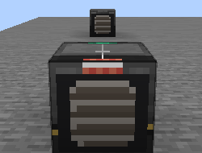

# Ex Mekanism Deorum

Ex Deorum の機械 (ハンマー / ふるい / バレル / るつぼ) を **Mekanism の機械**として追加するアドオンです。
FE 給電・アップグレード・側面設定つきで、Ex Deorum のレシピをそのまま自動化できます。

## 概要

Ex Deorum の「手作業の機械」を Mekanism のマシンとして再実装しました。
レシピは Ex Deorum 側を直接参照するため、**データパックで追加したレシピもそのまま動きます**。

- 無印の機械 5 種 + Basic / Advanced / Elite / Ultimate のファクトリー 20 種 (計 25 ブロック)
- Mekanism のアップグレード (スピード / エネルギー / マフリング)、側面設定、セキュリティ、
  レッドストーン制御に対応
- ファクトリーは Basic 3 / Advanced 5 / Elite 7 / Ultimate 9 レーンの並列処理
  (るつぼのみ溶解速度 5/10/20/30 倍)
- 圧縮ハンマーをセットすると `compressed_hammer` レシピも処理
- JEI 対応 (Ex Deorum のカテゴリに触媒として追加。進行バークリックでレシピを開く)

## 必要環境

| 項目 | バージョン |
| --- | --- |
| Minecraft | 1.21.1 |
| NeoForge | 21.1.265 以降 |
| Ex Deorum | 3.12 以降 (必須) |
| Mekanism | 10.7.19 以降 (必須) |
| JEI | 任意 |

クライアント・サーバーの両方に入れてください。コンフィグはありません。

## 導入

1. Minecraft 1.21.1 + NeoForge 21.1.265 の環境を用意する
2. Ex Deorum と Mekanism を `mods/` に入れる
3. この Mod の jar を `mods/` に入れる

## 追加される機械

| ファミリー | 無印 | ファクトリー | 消費 |
| --- | --- | --- | --- |
| ハンマー | ハンマー機 | Basic〜Ultimate ハンマーファクトリー | 20 FE/t |
| ふるい | ふるい機 | Basic〜Ultimate ふるいファクトリー | 40 FE/t |
| バレル | バレル機 | Basic〜Ultimate バレルファクトリー | 10 FE/t |
| 溶岩るつぼ | 溶岩るつぼ機 | Basic〜Ultimate るつぼファクトリー | 20 FE/t × 溶解倍率 |
| 水るつぼ | 水るつぼ機 | Basic〜Ultimate 水るつぼファクトリー | 20 FE/t × 溶解倍率 |

るつぼファクトリーはレーンを増やさず、溶解速度が Basic 5 倍 / Advanced 10 倍 /
Elite 20 倍 / Ultimate 30 倍になります (電力も同じ倍率)。

## 使い方

### ハンマー / ふるい

- ハンマースロット (スロット 22) にハンマー、ふるいにはメッシュが必須
- 処理中のアイテムは入力スロットに残り、完了時にだけ 1 個消費
- ハンマーは効率 / 幸運、ふるいはメッシュの効率 / 幸運が効く
- 圧縮ハンマーを入れると圧縮ブロックを `compressed_hammer` レシピで処理
  (入力とハンマーの挿入順は問いません)

### バレル

- アイテム入力 2 スロット、アイテム出力 1 スロット、液体入力 / 出力タンク (各 1000 mB × 並列数)
- 堆肥化・アイテム+液体の混合・真上の液体との混合・下 3×3 の触媒による液体変換・雨天給水に対応
- 堆肥は入れた瞬間に貯まり、進行バーが「貯まった割合」→「土を作る工程」に切り替わります

### るつぼ

- **溶岩るつぼ**: 1 個ずつ溶解。真下のブロックの熱値で速度が決まり、熱源がないと進みません
- **水るつぼ**: `water_crucible` レシピ専用。熱源不要
- 出力は液体タンクのみ (パイプで取り出し)

## クラフトレシピ

無印の機械は `ACA / IPI / ACA` (A = 赤石, C = 基本制御回路, I = 鉄インゴット) で、
中央に Ex Deorum の機械パーツを置きます。

| 機械 | 中央 |
| --- | --- |
| ハンマー機 | 機械式ハンマー |
| ふるい機 | 機械式ふるい |
| バレル機 | オークのバレル |
| 溶岩るつぼ / 水るつぼ | 磁器るつぼ + 最下段に溶岩入り / 水入りバケツ |

ファクトリーは Mekanism の工場と同じ段階アップグレードです
(Basic → Advanced → Elite → Ultimate)。

## 既知の制限

- テクスチャと GUI は仮アセットです (今後調整予定)
- `compressed_sieve` レシピは未対応 (圧縮ハンマーは対応)
- バレルの熱い液体による焼失は未実装

## クレジット

- 作者: codeonigiri
- ブロックのベーステクスチャと GUI 背景: Mekanism (MIT License,
  Copyright Aidancbrady and contributors)
- Ex Deorum のレシピ・タグ・機械パーツを利用: thedarkcolour / Ex Deorum

## リンク

- GitHub: <https://github.com/code-onigiri/Ex-Mekanism-Deorum>
- ライセンス: MIT
