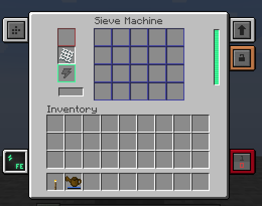
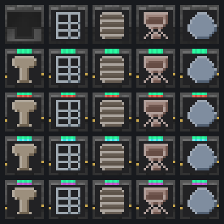

# Ex Mekanism Deorum

An addon that reimagines **Ex Deorum** machines (Hammer, Sieve, Barrel, and Crucible) as **Mekanism** machines.
Automate all your Ex Deorum processing with FE power, upgrades, and full side configuration support.

## Overview

Ex Deorum's manual and mechanical machines are re-implemented using Mekanism's machine architecture.
Because recipes are directly referenced from Ex Deorum at runtime, **custom recipes added via datapacks work out of the box**.

- **90 Blocks**: 5 Base Machines + 85 Tiered Factories (Mekanism's Basic/Advanced/Elite/Ultimate, plus the extra tiers added by Evolved Mekanism, Mekanism Extras and Evolved Mekanism Extras)
- Full Mekanism integration: Upgrades (Speed, Energy, Muffling), Side Configuration, Security, and Redstone control
- Factory parallelism: 3 / 5 / 7 / 9 parallel lanes for Basic, Advanced, Elite, and Ultimate (Crucibles scale melting speed by 5x / 10x / 20x / 30x instead)
- Optional addon tiers: Evolved Mekanism (Overclocked 11, Quantum 13, Dense 15, Multiversal 17, Creative 19 lanes), Mekanism Extras (Absolute 11, Supreme 13, Cosmic 15, Infinite 17 lanes) and Evolved Mekanism Extras (Absolute Overclocked 12, Supreme Quantum 14, Cosmic Dense 16, Infinite Multiversal 18 lanes) — the blocks and recipes are only registered when the matching addon is installed, and their tier installers can upgrade the factories
- Compressed Hammer support: inserting a compressed hammer enables `compressed_hammer` recipes automatically
- JEI integration: registered as catalysts for Ex Deorum categories; click the GUI progress bar to jump directly to recipes

## Requirements

| Requirement | Version |
| --- | --- |
| Minecraft | 1.21.1 |
| NeoForge | 21.1.265 or higher |
| Ex Deorum | 3.12 or higher (Required) |
| Mekanism | 10.7.19 or higher (Required) |
| JEI | Optional |

Install on both client and server. No configuration file needed.

## Installation

1. Set up a Minecraft 1.21.1 environment with NeoForge (>= 21.1.265).
2. Place **Ex Deorum** and **Mekanism** into your `mods/` directory.
3. Place this mod's jar file into your `mods/` directory.

## Machines & Factories

| Family | Base Machine | Tiered Factories | Base Consumption |
| --- | --- | --- | --- |
| Hammer | Hammer Machine | Basic – Ultimate Hammer Factory | 20 FE/t |
| Sieve | Sieve Machine | Basic – Ultimate Sieve Factory | 40 FE/t |
| Barrel | Barrel Machine | Basic – Ultimate Barrel Factory | 10 FE/t |
| Lava Crucible | Crucible Machine | Basic – Ultimate Crucible Factory | 20 FE/t × melt multiplier |
| Water Crucible | Water Crucible Machine | Basic – Ultimate Water Crucible Factory | 20 FE/t × melt multiplier |

Crucible factories do not use parallel lanes; instead, their melting speed scales by **5x (Basic) / 10x (Advanced) / 20x (Elite) / 30x (Ultimate)** with matching energy consumption (energy per mB produced remains constant).

## Machine Details

### Hammer & Sieve

- **Hammer Machine**: Requires a hammer in the auxiliary slot (slot 22). Durability is consumed per operation. Supports Efficiency and Fortune enchantments. Output distributes into 20 output slots.
  - Inserting a compressed hammer (`#exdeorum:compressed_hammers`) enables processing compressed blocks via `compressed_hammer` recipes.
- **Sieve Machine**: Requires a mesh in the auxiliary slot (slot 22). Mesh Efficiency and Fortune enchantments apply. Hand-only recipes are ignored mechanically.
- **Item Consumption**: Input items remain in their slot while processing and are only consumed by 1 upon operation completion.

### Barrel

- Features 2 item input slots, 1 item output slot, and dedicated fluid input & output tanks (1,000 mB × parallel lane count each).
- Supports composting, item + fluid mixing, in-world fluid mixing (fluid block above), catalyst transformation (3×3 blocks below), and rainwater filling.
- **Composting**: Added biomass fills the compost buffer instantly; the progress bar tracks compost fill percentage, then switches to the dirt creation phase.
- Fluid inputs only accept external filling when the barrel is idle (compost buffer is 0 and item inputs are empty).

### Crucible

- **Lava Crucible**: Melts solid items one by one into fluid. Melting speed depends on the heat value of the block directly underneath (`crucible_heat_source`). Without a heat source, no energy or items are consumed.
- **Water Crucible**: Dedicated to `water_crucible` recipes. Requires no heat source (fixed base rate).
- Fluid outputs can only be extracted via fluid pipes (no manual bucket insertion into the output tank).

## Crafting Recipes

Base machines use the standard Mekanism machine ring: `ACA / IPI / ACA` (A = Redstone, C = Basic Control Circuit, I = Iron Ingot), surrounding the corresponding Ex Deorum mechanical part `P`:

| Machine | Center Part `P` |
| --- | --- |
| Hammer Machine | `exdeorum:mechanical_hammer` |
| Sieve Machine | `exdeorum:mechanical_sieve` |
| Barrel Machine | `exdeorum:oak_barrel` |
| Lava Crucible | `exdeorum:porcelain_crucible` (+ Lava Bucket at bottom center) |
| Water Crucible | `exdeorum:porcelain_crucible` (+ Water Bucket at bottom center) |

Tiered factories follow Mekanism's tier upgrade progression (Basic -> Advanced -> Elite -> Ultimate), crafting directly from the previous tier block.

## Known Limitations

- Textures and GUIs are currently placeholder assets (open for customization and tuning).
- Compressed blocks are sifted automatically with the installed mesh using the `compressed_sieve`
  recipes; no Compressed Hammer is needed in the sieve (use the Hammer Machine for that).
- Barrels taking fire damage from hot fluids is not implemented.

## Credits & License

- Author: codeonigiri
- Mod License: GNU General Public License v3.0 ([LICENSE](https://github.com/code-onigiri/Ex-Mekanism-Deorum/blob/main/LICENSE))
- Base textures and GUI base: Mekanism (MIT License, Copyright Aidancbrady and contributors)
- Recipe caches, tags, and item parts: [Ex Deorum](https://github.com/thedarkcolour/ExDeorum) by thedarkcolour

## Links

- GitHub: <https://github.com/code-onigiri/Ex-Mekanism-Deorum>

## Optional Integrations

All of the following are optional; the mod works without them.

- **Evolved Mekanism / Mekanism Extras / Evolved Mekanism Extras** — their tier installers can upgrade these factories from Basic through the addon tiers (Evolved: Overclocked..Creative; Extras: Absolute..Infinite; EM Extras: Absolute Overclocked..Infinite Multiversal).
- **Mekanism: Empowered** — its speed/energy upgrades apply automatically through Mekanism's upgrade path.
- **Mek Energistics** — the machines are registered with the AE2 pattern automation SPI (item and fluid I/O, persistent hammer/mesh inputs, factory parallelism).
- **JEI** — Ex Deorum recipes list these machines as catalysts.
